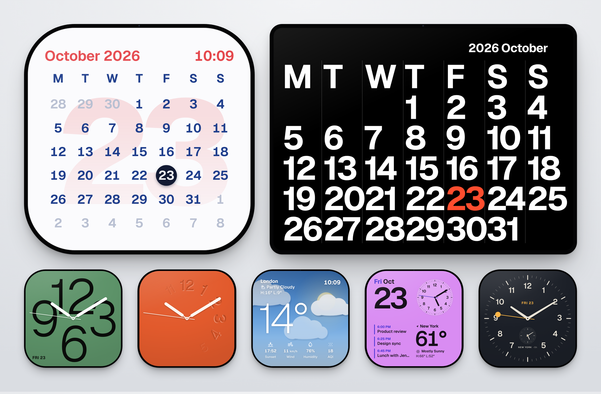

# Bezel

**Clocks, calendars and weather, sharp on every screen.**

[](https://hub.xerj.org/contributors/ShazMoghaddam)

Bezel is a set of free, open-source web components: five tiles drawn entirely in vectors, so they stay crisp from a 120 px widget to a 4K desk display. Design one in the Studio, paste one line of HTML into any site, turn a spare iPad into a desk clock, or put tiles on your Mac desktop.



**[Open the Studio](https://shazmoghaddam.github.io/bezel/site/)** to design a tile and copy its code.

- **Sharp at any size.** Every face is SVG and CSS sized in container units.
- **Yours to style.** Any colour, a light and a dark colour set, three typefaces ready to go, rounder or squarer corners, with or without the bezel.
- **Live data, no keys.** Weather and air quality from [Open-Meteo](https://open-meteo.com), free and keyless. Agendas from standard `.ics` calendar feeds.
- **Speaks your language.** Dates, times and weather words in English, French, German, Spanish, Italian, Japanese and Persian.
- **Light.** About 25 kB gzipped with no dependencies and no build step. Every tile on a page shares one timer and pauses when off screen.
- **Accessible.** Each tile describes itself to screen readers and respects reduced-motion settings.

## Contents

- [Quick start](#quick-start)
- [The Studio](#the-studio)
- [The tiles](#the-tiles)
- [Options for every tile](#options-for-every-tile)
- [Colours and dark mode](#colours-and-dark-mode)
- [Typefaces](#typefaces)
- [Languages](#languages)
- [Weather and calendar data](#weather-and-calendar-data)
- [Desk display](#desk-display)
- [macOS desktop (Übersicht)](#macos-desktop-übersicht)
- [Frameworks](#frameworks)
- [Upgrading from 1.x](#upgrading-from-1x)
- [Development](#development)

## Quick start

```html
<script type="module" src="https://cdn.jsdelivr.net/gh/ShazMoghaddam/bezel@v2.0.0/dist/bezel.min.js"></script>

<bezel-clock variant="relief" theme="ember"></bezel-clock>
<bezel-weather location="Lisbon"></bezel-weather>
```

That's all. Tiles are 320 px wide by default; set `--bezel-size` to change that:

```html
<bezel-clock style="--bezel-size: 480px"></bezel-clock>
```

Prefer a classic script tag? `dist/bezel.iife.js` registers the same elements and exposes a `Bezel` global.

With npm, straight from GitHub:

```sh
npm install github:ShazMoghaddam/bezel
```

```js
import 'bezel-tiles';                        // registers every element
import { time, weather } from 'bezel-tiles'; // helpers, if you want them
```

## The Studio

The [Studio](https://shazmoghaddam.github.io/bezel/site/) is the easiest way to make a tile. Pick a component, then work through the tabs on the right while the preview updates beside them:

- **Style:** face, numerals, frame, size, corners and typeface
- **Colours:** every colour in one place, plus an optional dark mode set
- **Hands:** the hand design and seconds options, on tiles with a dial
- **Options:** what the tile shows, such as the date, a second time zone, the weather location or a calendar link
- **Time:** time zone, 12 or 24 hours, and language, wherever they change something

The Studio only offers settings that have a visible effect on the tile you're editing. When you're done, **Get the code** gives you the HTML, a desk display link, or an entry for the Mac widget. **Share** copies a link that opens your exact design in the Studio. The page address also updates as you work, so you can bookmark a design or come back to it later.

## The tiles

### `<bezel-clock>`

An analog clock with three faces: **Numerals**, with four huge overlapping numbers behind the hands; **Relief**, with numerals pressed into the surface that rise as the minute hand passes; and **Classic**, a clean railway dial.

| Attribute         | Values                                         | Default            |
| ----------------- | ---------------------------------------------- | ------------------ |
| `variant`         | `numerals`, `relief`, `classic`                | `numerals`         |
| `numerals`        | `western`, `roman`, `persian`                  | `western`          |
| `hands`           | `modern`, `lollipop`                           | `modern`           |
| `theme`           | `sage`, `cobalt`, `ember`, `graphite`, `blush`, `stone`, `midnight`, `porcelain` | depends on the face |
| `sweep`           | `smooth`, `tick`                               | `smooth`           |
| `hide-seconds`    | boolean                                        | off                |
| `hide-date`       | boolean                                        | off                |
| `second-timezone` | Classic face only: another city, e.g. `Asia/Tokyo` |                |
| `second-label`    | name under the second dial                     | the city's name    |

`hands="lollipop"` swaps the slim original hands for tapered batons, a pivot cap and a seconds hand that ends in a round dot. A second time zone replaces the 6 with a small dial showing the city and the time difference, for example "NEW YORK −5h". Roman numerals write four as IIII, as most clock dials do.

### `<bezel-calendar>`

A month at a glance, with today's date set huge behind the grid.

| Attribute       | Values                                 | Default        |
| --------------- | -------------------------------------- | -------------- |
| `theme`         | `snow`, `ink`, `sorbet`, `forest`      | `snow`         |
| `week-start`    | `mon`, `sun`, or `0` to `6`            | from `locale`  |
| `month`         | `YYYY-MM` to pin a month               | current month  |
| `hide-time`     | boolean                                | off            |
| `hide-backdrop` | boolean, removes the giant day number  | off            |

### `<bezel-weather>`

Current conditions over a sky drawn from the live weather and time of day: sun, moon and stars, clouds, rain, snow, fog and storms.

| Attribute               | Values                                  | Default        |
| ----------------------- | --------------------------------------- | -------------- |
| `location`              | a place name, e.g. `Kyoto`              | London         |
| `latitude`, `longitude` | decimal degrees (skips the name lookup) |                |
| `units`                 | `metric`, `imperial`                    | from `locale`  |
| `refresh`               | minutes between updates, minimum 5      | `15`           |
| `hide-time`             | boolean                                 | off            |
| `still`                 | boolean, stops the sky animation        | off            |

Shows the temperature, today's high and low, the next sunrise or sunset, wind, humidity and air quality (European AQI for metric, US AQI for imperial).

### `<bezel-glance>`

A dashboard in one tile: the date, an analog clock, the weather, and either today's agenda or how far through the year you are.

| Attribute      | Values                                          | Default  |
| -------------- | ----------------------------------------------- | -------- |
| `theme`        | `mist`, `orchid`, `sand`, `slate`               | `mist`   |
| `hands`        | `modern`, `lollipop`                            | `modern` |
| `ics`          | URL of an `.ics` calendar feed                  |          |
| `events`       | JSON array of `{ title, start, end, location }` |          |
| `max-events`   | number                                          | `3`      |
| `hide-weather` | boolean, shows the week number instead          | off      |
| plus `location`, `latitude`, `longitude`, `units` and `refresh` from `<bezel-weather>` | | |

Events that have finished drop off as the day goes on.

### `<bezel-poster>`

A month in oversized type, in the tradition of big wall calendars. Landscape (4:3) with no frame by default; its bezel, when you add one, matches a square tile of the same height.

| Attribute      | Values                              | Default        |
| -------------- | ----------------------------------- | -------------- |
| `theme`        | `noir`, `paper`, `signal`, `bone`   | `noir`         |
| `week-start`   | `mon`, `sun`, or `0` to `6`         | from `locale`  |
| `month`        | `YYYY-MM`                           | current month  |
| `no-highlight` | boolean, doesn't colour today       | off            |

Pin a month and it makes a good print or poster at any resolution.

## Options for every tile

| Attribute    | Values                                        | Default                     |
| ------------ | --------------------------------------------- | --------------------------- |
| `frame`      | `device`, `bezel`, `none`                     | `device` (`none` on poster) |
| `theme`      | one of the tile's themes                      | the tile's default          |
| `dark-theme` | a theme to use in dark mode                   | none                        |
| `appearance` | `light` or `dark` to fix one look; leave it out to follow the device | follows the device |
| `timezone`   | any IANA zone, e.g. `America/New_York`        | the viewer's device         |
| `locale`     | a language tag, e.g. `fr-FR`                  | the viewer's browser        |
| `hour-cycle` | `12`, `24`                                    | from `locale`               |

`device` is a thin black bezel of even width with a camera dot and a soft shadow; `bezel` is the black border alone; `none` is just the screen, for when the tile sits inside your own design. The frame is also exposed as CSS parts: `::part(frame)`, `::part(bezel)` and `::part(screen)`.

## Colours and dark mode

Pick a theme, then override any colour with CSS variables. Your values always win.

```css
bezel-clock.brand {
  --bezel-surface: #0f3d3e;
  --bezel-ink: #f1ede4;
  --bezel-hand: #f1ede4;
  --bezel-accent: #ff7a59;
}
```

**Dark mode.** Tiles follow the device's light or dark setting. Give a tile a `dark-theme`, or set any colour again with a `--bezel-dark-` prefix, and it switches by itself:

```html
<bezel-clock theme="porcelain" dark-theme="midnight"></bezel-clock>

<bezel-calendar style="--bezel-surface: #fff8ec; --bezel-dark-surface: #1a1410"></bezel-calendar>
```

In dark mode each colour comes from `--bezel-dark-*` first, then the `dark-theme`, then the normal colour, so a tile with no dark settings looks the same in both. Add `appearance="light"` or `appearance="dark"` to fix one look, for example on a desk display.

| Variable                         | What it sets                                         |
| -------------------------------- | ---------------------------------------------------- |
| `--bezel-size`                   | width of the tile (the height follows)               |
| `--bezel-aspect`                 | aspect ratio, e.g. `16 / 9`                          |
| `--bezel-radius`                 | corner radius in `cqw` (`22cqw` default); content moves in as corners get rounder |
| `--bezel-thickness`              | width of the black bezel (`1.7cqw` default)          |
| `--bezel-font`                   | typeface for every tile                              |
| `--bezel-surface`                | screen background                                    |
| `--bezel-ink`                    | text and numerals                                    |
| `--bezel-accent`                 | highlights, the seconds hand, today                  |
| `--bezel-hand`                   | clock hands, on the clock and the glance dial        |
| `--bezel-today`, `--bezel-muted` | calendar: today's circle and other months' days      |
| `--bezel-soft`                   | glance: the clock plate                              |
| `--bezel-rule`                   | poster: the column rules                             |
| `--bezel-tint`                   | weather: recolours the sky but keeps clouds and light |
| `--bezel-numeral-weight`         | weight of the big numbers on the Numerals face       |
| `--bezel-dark-*`                 | any colour above, for dark mode                      |

## Typefaces

Bezel doesn't download fonts itself. On Apple devices it uses SF Pro, the system font; elsewhere it uses [Geist](https://fonts.google.com/specimen/Geist) if your page loads it. The Studio also offers [Fraunces](https://fonts.google.com/specimen/Fraunces), a serif, and [Nunito](https://fonts.google.com/specimen/Nunito), a rounded sans, and adds the line that loads your choice to the copied code. Any other font works too: load it and set `--bezel-font`.

```html
<link rel="stylesheet" href="https://fonts.googleapis.com/css2?family=Fraunces:opsz,wght@9..144,300..800&display=swap">
<bezel-calendar style="--bezel-font: 'Fraunces', serif"></bezel-calendar>
```

## Languages

Month and day names, dates and times come from the browser's own `Intl` support, so they work in any language. The words Bezel draws itself (weather conditions, Sunrise, Wind, "Week 43", "All day" and so on) are translated into English, French, German, Spanish, Italian, Japanese and Persian, and fall back to English for other languages. Set `locale`, or leave it out to follow the viewer's browser.

## Weather and calendar data

**Weather** comes from Open-Meteo's forecast and air-quality APIs. Requests for the same place are shared between tiles and cached for 15 minutes. If the network fails, the tile shows plausible values marked **Sample**, so nobody mistakes them for real readings. Open-Meteo's free tier is for non-commercial use; see [their terms](https://open-meteo.com/en/terms) if you're building a product.

To supply your own data, assign it in JavaScript:

```js
document.querySelector('bezel-weather').weather = {
  place: 'Oslo', units: 'metric', temperature: -3, high: -1, low: -6,
  condition: 'Snow', sky: 'snow', isDay: false, humidity: 88, wind: 9,
  sunrise: ['2026-12-01T08:58'], sunset: ['2026-12-01T15:17'], aqi: 12, aqiScale: 'eu',
};
```

`sky` is one of `clear`, `partly`, `cloudy`, `fog`, `drizzle`, `rain`, `snow`, `storm`.

**Calendars.** `<bezel-glance>` reads events from the `ics` attribute, the `events` attribute or property, or raw `.ics` text assigned to the `icsText` property. The reader handles time zones, all-day events, cancellations, and daily, weekly, monthly and yearly repeats with exceptions.

Most private feeds (Google, iCloud, Outlook) don't let browsers fetch them directly. Three ways round that:

1. On a Mac, use the Übersicht widget: it downloads feeds with `curl`, which isn't restricted.
2. Fetch the feed on your own server and pass the text to `tile.icsText`.
3. Serve the feed through a proxy that adds an `Access-Control-Allow-Origin` header.

When a feed can't be read, the tile shows how far through the year you are instead.

## Desk display

`site/display.html` shows one tile full screen on black. It keeps the screen awake where the browser allows, hides the cursor when idle, goes full screen on tap, and shifts the tile a few pixels each minute so OLED screens don't burn in.

Every query parameter becomes an attribute, and parameters starting with `--` become CSS variables:

```
https://shazmoghaddam.github.io/bezel/site/display.html?tile=clock&variant=relief&theme=ember&--accent=%23ffffff
```

The Studio's **Desk display** card builds these links for you. On an iPad, open the link in Safari and choose **Share › Add to Home Screen** for a full-screen clock with no browser bars.

## macOS desktop (Übersicht)

`ubersicht/bezel.widget` is a ready-made [Übersicht](https://tracesof.net/uebersicht/) widget. Copy it into Übersicht's widgets folder and edit its `TILES` list; the Studio's **macOS desktop** card writes an entry for the tile you designed, colours included. See [`ubersicht/README.md`](ubersicht/README.md).

## Frameworks

Bezel elements are standard custom elements, so they work anywhere HTML does.

**React 19** passes attributes and properties to custom elements directly:

```jsx
import 'bezel-tiles';

export function DeskClock() {
  return <bezel-clock variant="numerals" theme="cobalt" style={{ '--bezel-size': '280px' }} />;
}
```

**Vue** needs to know the `bezel-` prefix is a custom element: set `compilerOptions.isCustomElement = (tag) => tag.startsWith('bezel-')`.

**Browser support:** current Safari (16.4 or later), Chrome, Edge and Firefox. Bezel uses container query units, `color-mix()` and Shadow DOM.

## Upgrading from 1.x

Version 2.0 replaces the time-based `night-theme` and `night-hours` attributes with dark mode that follows the device. If you used them, swap `night-theme` for `dark-theme` and remove `night-hours`. Anything pinned to `@v1.x` on jsDelivr keeps working as before. Everything else is unchanged.

## Development

```sh
git clone https://github.com/ShazMoghaddam/bezel.git
cd bezel
npm install
npm run serve        # http://localhost:4173/site/
npm run check        # build, run the tests, and check the size budget
```

```
src/
  core/        the base element, frame, hands, time, calendar maths, weather, .ics parsing, translations
  tiles/       one file per element
site/          the website, Studio and desk display
docs/          the README image and social preview, with the pages that render them
ubersicht/     the macOS desktop widget
test/          node:test suites
```

Each tile extends `BezelElement`, which handles the frame, colours, shadow DOM, the shared ticker and visibility. A new tile needs a `template()` that returns its markup and an `update()` that moves whatever changes each tick. The bundle has a 27 kB gzip budget, checked in CI. See [CONTRIBUTING.md](CONTRIBUTING.md).

## Credits

Weather data by [Open-Meteo](https://open-meteo.com) (CC BY 4.0). Typefaces Geist, Fraunces and Nunito (SIL Open Font License). Designed and built by [Shaz Moghaddam](https://shazmoghaddam.github.io), London.

## Licence

[MIT](LICENSE)
